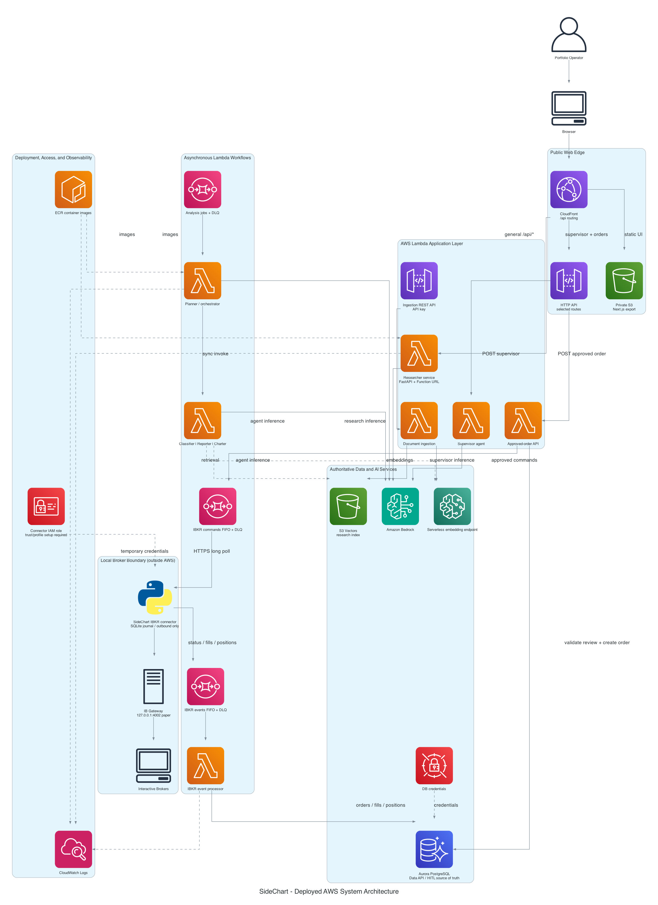

# SideChart



SideChart is a human-in-the-loop, agent-assisted market research and paper
trading platform. It combines a static Next.js application, AWS Lambda agents,
Amazon Bedrock, quantitative market analysis, Aurora PostgreSQL, and a local
Interactive Brokers connector.

The database is the source of truth for research signals, supervisor reviews,
approved orders, executions, portfolio snapshots, connector events, and model
usage. Agent output never bypasses human review to become an IBKR order.

> SideChart is intended for research, human
> review, and paper-trading workflows. It is not personalized investment advice
> and does not guarantee investment performance.

## AWS Architecture

### Web delivery and API routing

The local Next.js frontend is exported as static assets and uploaded to a
private S3 bucket. CloudFront is the public application entry point and uses an
Origin Access Control to read the bucket.

CloudFront sends API traffic to two AWS origins:

- General `/api/*` requests go to the researcher Lambda Function URL. That
  container hosts the FastAPI-compatible market, signal, pipeline, research,
  portfolio, and dry-run routes.
- `POST /api/agents/supervisor/run` and
  `POST /api/broker/ibkr/orders` go through the frontend HTTP API Gateway to
  their dedicated Lambda functions.

Long-running research requests can call the researcher Function URL directly,
avoiding the shorter HTTP API integration timeout.

### Agent services

The AWS agent layer contains these Lambda container images:

| Service | Responsibility | Invocation path |
|---|---|---|
| Researcher service | Browser research, Playwright MCP browsing, market pipeline compatibility routes | Lambda Function URL |
| Supervisor agent | Produces a human-reviewable rebalance proposal; does not execute trades | HTTP API Gateway |
| Sell-side agent | Dedicated sell-side research runtime | Standalone Lambda invocation |
| Planner | Coordinates the legacy asynchronous analysis workflow | Analysis-jobs SQS queue |
| Classifier | Classifies instruments for the planner | Synchronous planner invocation |
| Reporter | Produces report output and retrieval-assisted analysis | Synchronous planner invocation |
| Charter | Produces structured chart data | Synchronous planner invocation |

The agents use Amazon Bedrock through the Agents SDK/LiteLLM integration. The
researcher can use Playwright MCP for web research and yfinance-backed contracts
for market data. Reporter retrieval uses S3 Vectors and the serverless SageMaker
embedding endpoint. CloudWatch contains Lambda logs; Langfuse tracing is
optional when its environment variables are configured.

The analysis-jobs queue currently triggers the planner, but the browser and
researcher routes do not yet publish new jobs to that queue.

### Data and ingestion

Aurora PostgreSQL Serverless v2 is accessed through the RDS Data API. Database
credentials are held in AWS Secrets Manager. Ordered SQL migrations define the
HITL trading schema:

- `research_signals`
- `supervisor_reviews`
- `orders`
- `executions`
- `portfolio_positions`
- `agent_tokens_audit`
- `broker_connectors`
- `broker_events`

The separate ingestion REST API uses an API key and invokes the ingestion
Lambda. Documents are embedded with SageMaker and stored in the S3 Vectors
research index.

The complete relational model is documented in
[docs/database_schema](docs/database_schema/README.md).

### HITL order and IBKR execution path

The approved-order endpoint accepts only a `supervisor_review_id`. It does not
trust ticker, side, quantity, or price values supplied by the browser. The
Lambda locks and validates the database review, requires `APPROVED` or
`MODIFIED` status, creates one idempotent `orders` row, and publishes a paper
order command to the IBKR commands FIFO queue.

```text
supervisor review in Aurora
        │
        ▼
approved-order Lambda
        │
        ▼
IBKR commands FIFO queue
        │ outbound HTTPS long polling
        ▼
local SideChart connector ── 127.0.0.1:4002 ── IB Gateway ── IBKR
        │
        ▼
IBKR events FIFO queue
        │
        ▼
event-processor Lambda ── orders / fills / positions ── Aurora
```

The connector runs on the same computer as IB Gateway. It uses a SQLite command
journal and durable event outbox, enforces paper/live mode and local order
limits, and refuses ambiguous retries rather than risking a duplicate order.
AWS never opens an inbound connection to the Gateway computer, and the IBKR API
port must not be exposed to the internet.

Terraform creates the connector IAM role and its least-privilege SQS policy.
An IAM Roles Anywhere trust anchor/profile and local `credential_process` still
need to be configured before an always-on connector can obtain temporary AWS
credentials.

More detailed diagrams are available in
[docs/architecture](docs/architecture/README.md), including the dedicated
[agent architecture](docs/architecture/agent_architecture.png).

## Repository Layout

```text
frontend/                       Next.js dashboard
backend/server.py               Shared FastAPI-compatible API routes
backend/researcher/             AWS researcher service and Function URL image
backend/{planner,classifier}/   Asynchronous agent workflow
backend/{reporter,charter}/     Reporting and chart agents
backend/sell_side_agent/        Dedicated sell-side Lambda
backend/supervisor_agent/       Dedicated supervisor Lambda
backend/ibkr_order_api/         Approved-review order API
backend/ibkr_event_processor/   SQS-to-Aurora broker event consumer
backend/ibkr_connector/         Local outbound IBKR bridge
backend/database/               Migrations and database verification
src/contracts/                  Market, signal, risk, and execution contracts
src/agents/                     Shared local research/supervisor behavior
terraform/                      AWS infrastructure stacks and orchestration scripts
docs/architecture/              Generated AWS diagrams and Python sources
docs/database_schema/           PostgreSQL ERD and schema documentation
```

## Infrastructure Deployment

### Prerequisites

- AWS CLI authenticated to the target account
- Terraform
- Docker Desktop
- Python and `uv`
- Node.js and npm
- IB Gateway for connector testing

Terraform variables containing credentials are intentionally ignored by Git.
Configure the required `terraform.tfvars` files and the root `.env` before
deployment.

### Apply all configured stacks

Preview the dependency order:

```bash
python3 terraform/apply_all.py --dry-run
```

Apply the configured stacks:

```bash
python3 terraform/apply_all.py
```

The apply order is database, SageMaker, ingestion, agents, researcher, then
frontend. A fresh researcher deployment also requires a container image URI;
`backend/researcher/deploy.py` builds the image, pushes it to ECR, and writes the
local Terraform image override.

Apply and verify database migrations after the Aurora stack is available:

```bash
uv run python backend/database/run_migrations.py
uv run python backend/database/verify_database.py
```

Deploy or refresh the researcher image when its source changes:

```bash
uv run python backend/researcher/deploy.py
```

### Destroy all stacks

Preview the reverse dependency order:

```bash
python3 terraform/destroy_all.py --dry-run
```

Destroy the infrastructure:

```bash
python3 terraform/destroy_all.py
```

The destroy helper verifies and empties only the tagged Terraform-managed
frontend bucket, including versions, delete markers, and multipart uploads. It
then destroys the frontend first and the database last.

## Local Development

Install the Python and frontend dependencies:

```bash
uv sync
cd frontend
npm install
cd ..
```

Run the local backend and frontend together:

```bash
uv run run_local.py
```

Local services:

```text
Backend:  http://127.0.0.1:8000
Frontend: http://localhost:3000
API docs: http://127.0.0.1:8000/docs
```

The local API provides market data, technical signals, the analysis pipeline,
draft target weights, agent-compatible routes, dry-run execution, and direct
development connectivity to a local IB Gateway.

## Running the Local IBKR Connector

Use paper trading first. IB Gateway normally listens on `4002` for paper mode
and `4001` for live mode.

Copy the settings from
[backend/ibkr_connector/.env.example](backend/ibkr_connector/.env.example) into
the root `.env`, including the queue URLs returned by:

```bash
terraform -chdir=terraform/agents output -json ibkr_connector
```

Then run:

```bash
uv run python -m backend.ibkr_connector.main
```

Creating the configured kill-switch file immediately blocks new commands:

```text
.sidechart/IBKR_KILL_SWITCH
```

Live mode is rejected unless `IBKR_ALLOW_LIVE_TRADING=true`. Do not enable it
until paper order placement, restarts, duplicate delivery, partial fills, and
event replay have been tested.

## Primary API Routes

| Method | Route | Purpose |
|---|---|---|
| `GET` | `/health` | Backend health |
| `POST` | `/market-data` | yfinance-backed OHLCV retrieval |
| `POST` | `/signals/generate` | Technical signal generation |
| `POST` | `/pipeline/dev/analyze` | Market pipeline and draft weights |
| `POST` | `/agents/research/run` | Interactive sell-side research |
| `POST` | `/agents/supervisor/run` | Human-reviewable supervisor proposal |
| `POST` | `/broker/ibkr/orders` | Queue an existing approved database review |
| `GET` | `/broker/ibkr/status` | Broker connection/status contract |
| `POST` | `/execution/rebalance` | Local/dry-run rebalance contract |

The deployed browser prefixes proxied routes with `/api`. The researcher agent
uses its Function URL directly for long-running requests.

## Validation

Run the focused Python tests:

```bash
uv run python -m unittest \
  backend.database.test_run_migrations \
  backend.ibkr_connector.test_connector \
  backend.ibkr_event_processor.test_lambda_handler \
  backend.ibkr_order_api.test_lambda_handler
```

Validate Terraform stacks:

```bash
terraform -chdir=terraform/agents validate
terraform -chdir=terraform/frontend validate
```

Validate the frontend:

```bash
cd frontend
npm run lint
npx tsc --noEmit --incremental false
```

Regenerate architecture diagrams:

```bash
uv run python docs/architecture/system_architecture.py
uv run python docs/architecture/agent_design.py
uv run python docs/architecture/data_flow.py
```

## Current Integration Boundaries

- The deployed frontend still contains legacy direct buy/sell actions. Those
  actions are not yet wired to the approved-review API contract.
- The current IBKR status/holdings UI routes were originally designed for a
  process-local Gateway connection. They still need to read connector heartbeat
  and portfolio state from Aurora in the deployed AWS environment.
- Supervisor output is a reviewable proposal, but the UI does not yet persist a
  complete `supervisor_reviews` record automatically.
- The dedicated sell-side Lambda is deployed for standalone invocation, while
  the interactive research route runs inside the researcher service.
- The analysis-jobs queue has a planner consumer but no current browser producer.
- Public frontend APIs do not yet have replacement authentication after Clerk
  removal. Keep execution in paper mode until authentication and authorization
  are implemented.
- The planner, classifier, reporter, and charter folders retain parts of a
  legacy portfolio schema. Their SQS workflow requires further alignment with
  the current HITL trading tables before it should be treated as production.

## Safety

- Keep IBKR in paper mode during development.
- Never expose ports `4001`, `4002`, `7496`, or `7497` to the public internet.
- Treat `.env`, Terraform variable files, certificates, and AWS credentials as
  secrets.
- Require a persisted human approval before creating any broker command.
- Review all agent recommendations and validate prices, quantities, and account
  mode before execution.
