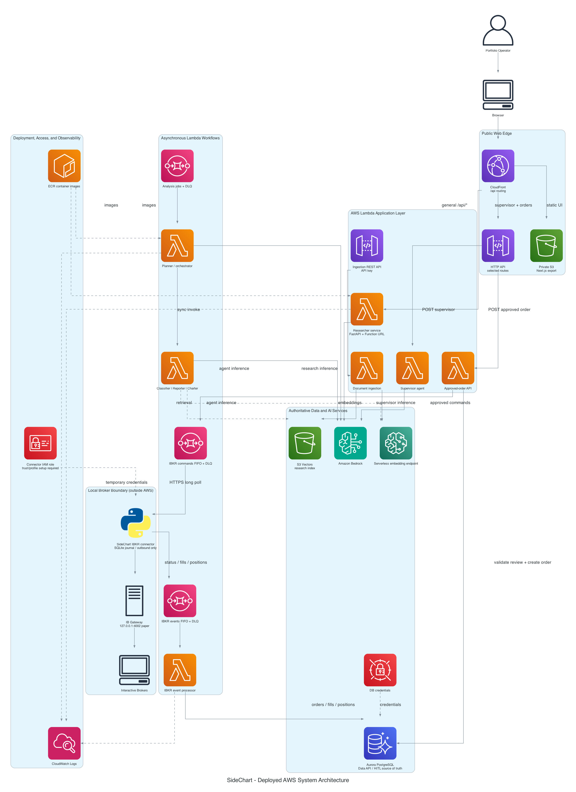
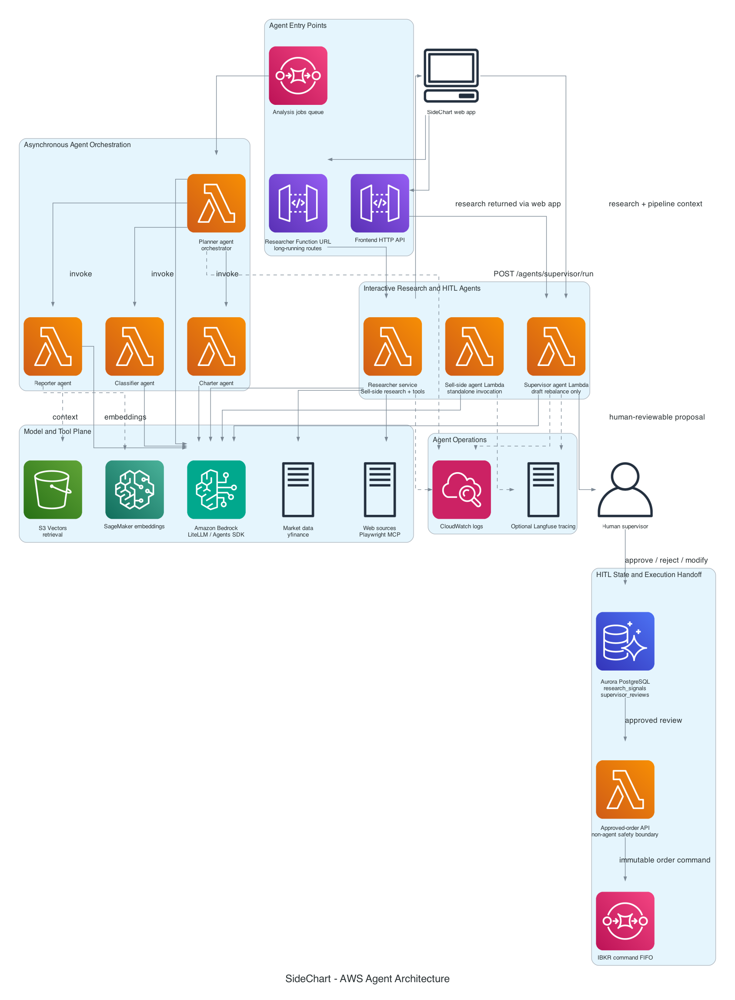
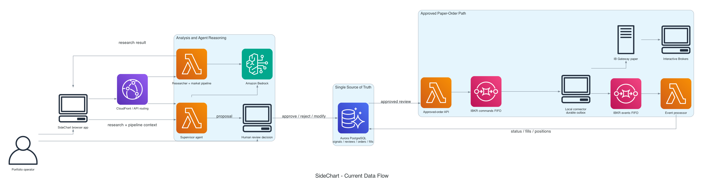

# SideChart AWS Architecture

These diagrams are generated from Python sources using the `diagrams` package
and Graphviz. They reflect the Terraform-managed AWS design and the local IBKR
connector boundary.

## System architecture



The system diagram covers the web edge, API routing, Lambda services, queues,
Aurora Data API, AI/data services, observability, deployment images, and the
outbound-only broker connector. Source: [`system_architecture.py`](./system_architecture.py).

## Agent architecture



The agent diagram separates the interactive researcher/supervisor workflow
from the SQS-triggered planner and its classifier, reporter, and charter
specialists. It also shows model/tool dependencies and the human approval
boundary before order creation. Source: [`agent_design.py`](./agent_design.py).

## Data flow



The data-flow view follows research through human review and the approved paper
order path to the local connector, IB Gateway, event processing, and Aurora.
Source: [`data_flow.py`](./data_flow.py).

## Current integration boundaries

- The analysis-jobs queue triggers the planner, but the current browser/researcher
  route does not publish jobs to it.
- The dedicated sell-side Lambda is deployed for standalone invocation; the
  interactive web research route currently runs through the researcher service.
- The approved-order API requires an existing `APPROVED` or `MODIFIED`
  `supervisor_reviews` row. Review persistence is the HITL handoff contract.
- Terraform creates the connector IAM role, command/event queues, and event
  processor. An IAM Roles Anywhere trust anchor/profile and local credentials
  still have to be configured before the connector can poll AWS.

Regenerate all diagrams from the repository root:

```bash
uv run python docs/architecture/system_architecture.py
uv run python docs/architecture/agent_design.py
uv run python docs/architecture/data_flow.py
```
