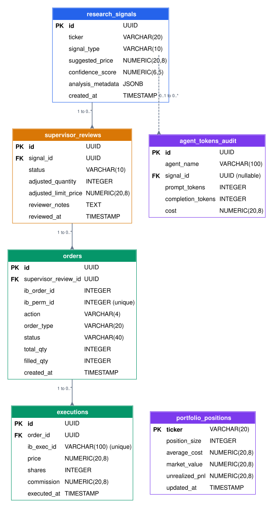

# SideChart Database Schema

This document describes the PostgreSQL schema for SideChart's human-in-the-loop (HITL) agentic trading workflow. The authoritative SQL definition is [`002_hitl_trading.sql`](../../backend/database/migrations/002_hitl_trading.sql).

## Entity-relationship diagram



The diagram is embedded as a standard SVG so it renders without Mermaid support. Its editable source is [`database_schema.dot`](./database_schema.dot).

## Relationship summary

| Parent | Child | Cardinality | Behavior |
|---|---|---|---|
| `research_signals` | `supervisor_reviews` | One signal to zero or many reviews | A referenced signal cannot be deleted. |
| `supervisor_reviews` | `orders` | One review to zero or many orders | A referenced review cannot be deleted. |
| `orders` | `executions` | One order to zero or many fills | A referenced order cannot be deleted. |
| `research_signals` | `agent_tokens_audit` | One signal to zero or many audit records; signal reference is optional | Deleting a signal sets the audit record's `signal_id` to `NULL`. |

`portfolio_positions` is intentionally independent. It stores the latest local IBKR position snapshot and is refreshed by ticker rather than tied to a particular recommendation or order.

## Workflow

```text
Research agent recommendation
        │
        ▼
research_signals
        │
        ▼
supervisor_reviews ── PENDING / APPROVED / REJECTED / MODIFIED
        │
        ▼
orders ────────────── IBKR order and lifecycle identifiers
        │
        ▼
executions ────────── one row per partial or complete fill
```

Token usage may be linked to the originating `research_signals` row through `agent_tokens_audit.signal_id`. Portfolio state is read from `portfolio_positions` before reasoning or order construction.

## Important integrity rules

- Signal types are restricted to `BUY`, `SELL`, and `HOLD`.
- Confidence scores must be between `0` and `1`.
- Non-pending supervisor reviews require `reviewed_at`; pending reviews must not have it.
- Filled quantity must remain between zero and the order's total quantity.
- `ib_exec_id` is unique so an IBKR fill cannot be recorded twice.
- Non-null `ib_perm_id` values are unique.
- Token counts and recorded model cost cannot be negative.

The operational `schema_migrations` table is maintained by the migration runner and is not part of the application ERD.
